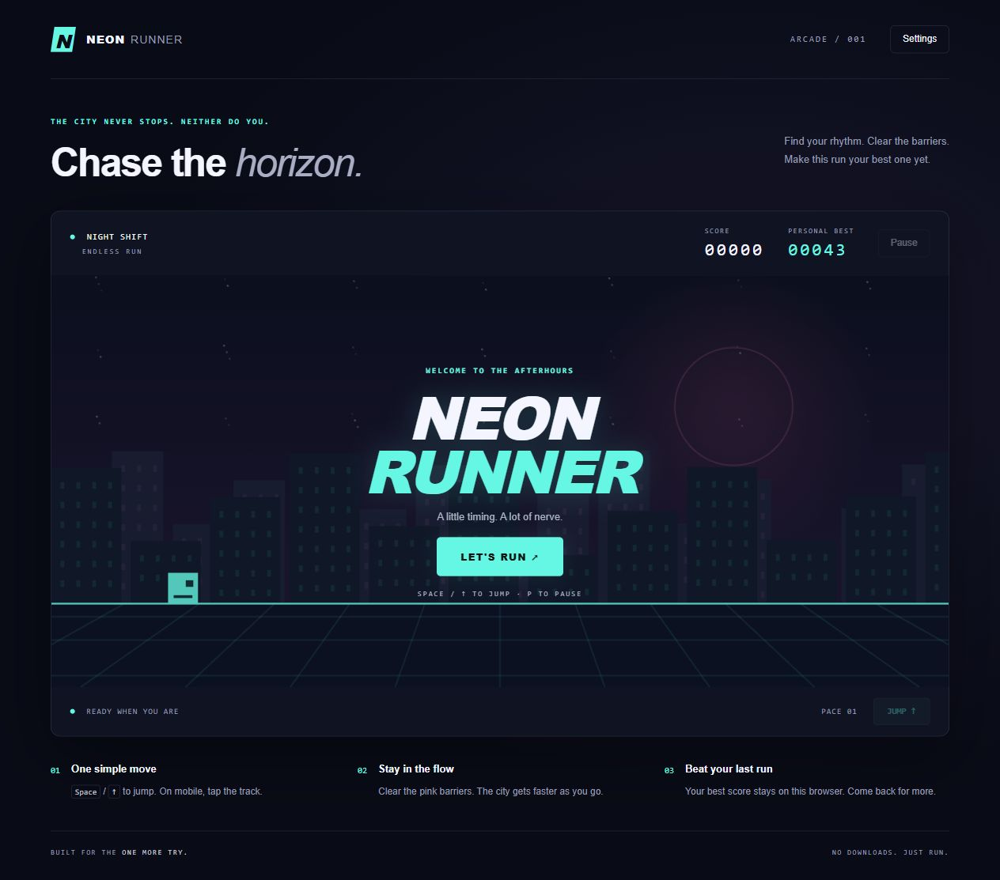

# Neon Runner

A small, dependency-free arcade game: jump over neon barriers, find your rhythm, and chase a new personal best.



## Play locally

Open `index.html` in a modern browser. No installation, account, backend, or build step is needed.

For consistent browser storage, serve the folder over localhost:

```sh
python -m http.server 8765 --bind 127.0.0.1
```

Then visit http://127.0.0.1:8765. Stop the server with Ctrl+C.

## Controls

- **Start / restart:** on-screen button (keyboard: Tab then Enter).
- **Jump:** Space, Arrow Up, W, tap the track, or the Jump button.
- **Pause / resume:** P, Escape, or the on-screen controls.
- **Settings:** optional synthesized sound and reduced background motion.
- Switching tabs or leaving the window pauses the game automatically.

The score measures distance. Speed increases gradually and is capped. Only one jump is allowed at a time; landing enables the next jump. Pink barriers end the run on contact.

## Features

- Canvas city skyline, neon track, runner and obstacles, drawn entirely in code.
- Responsive layout, keyboard and pointer controls.
- Best score and preferences stored only in this browser's local storage.
- Storage and audio failures do not prevent play.
- No analytics, accounts, network requests, third-party fonts, images or runtime packages.

## Development and checks

Node.js 20 or newer is needed only for automated checks. No npm installation is required.

```sh
npm run check
npm test
```

Tests cover jumping and landing, collisions, pause/resume, restarting, frame-rate consistency, high-speed obstacle clearance and spawn spacing. GitHub Actions runs the same checks on pushes and pull requests.

| File | Purpose |
| --- | --- |
| `index.html` | Interface and accessible controls |
| `style.css` | Responsive neon design |
| `engine.js` | Game state, physics, scoring and collisions |
| `script.js` | Canvas rendering, inputs, sound and saved preferences |
| `tests/engine.test.cjs` | Deterministic gameplay tests |

## Project history

The original user-created prototype had a start screen, placeholder button actions, and an empty stylesheet. It was imported into Git on November 4, 2026, without backdating. The playable game, design, documentation and tests were completed with AI assistance afterward. The original prototype remains available in the first commit.

## Limitations

This is a single-player visual timing game, not a fully screen-reader-playable game. Reduced motion reduces scenery effects but does not stop gameplay movement. Scores are local, not an online leaderboard. Clearing browser data clears the saved score. Audio may require a user gesture and browser support.

No open-source license has been selected yet; public availability alone does not grant reuse rights.
